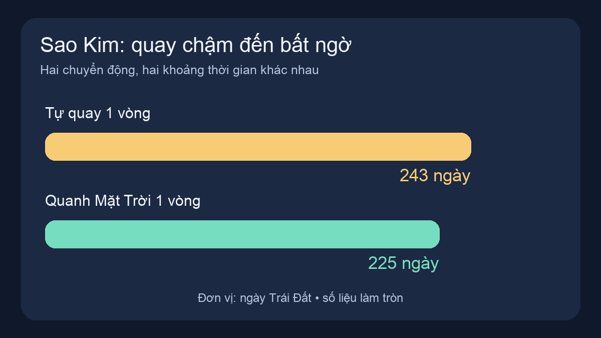
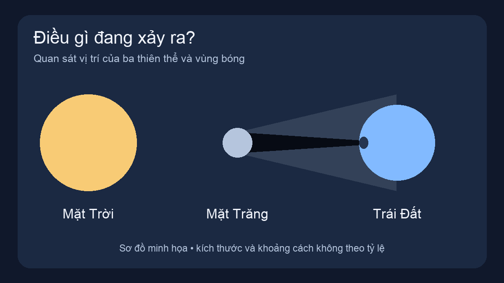
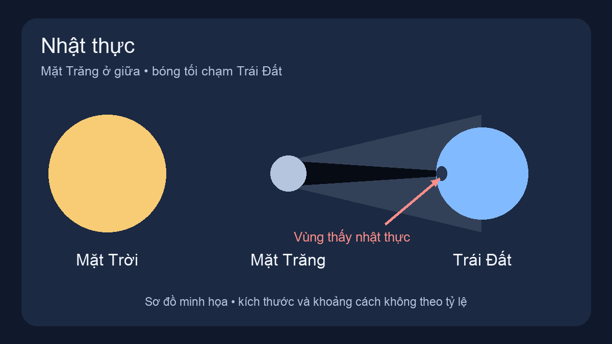
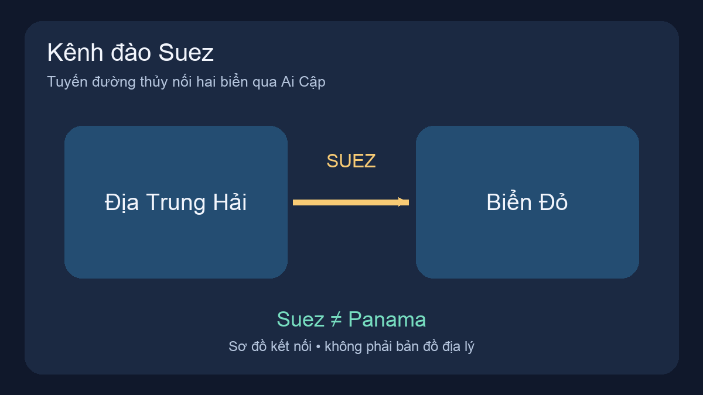
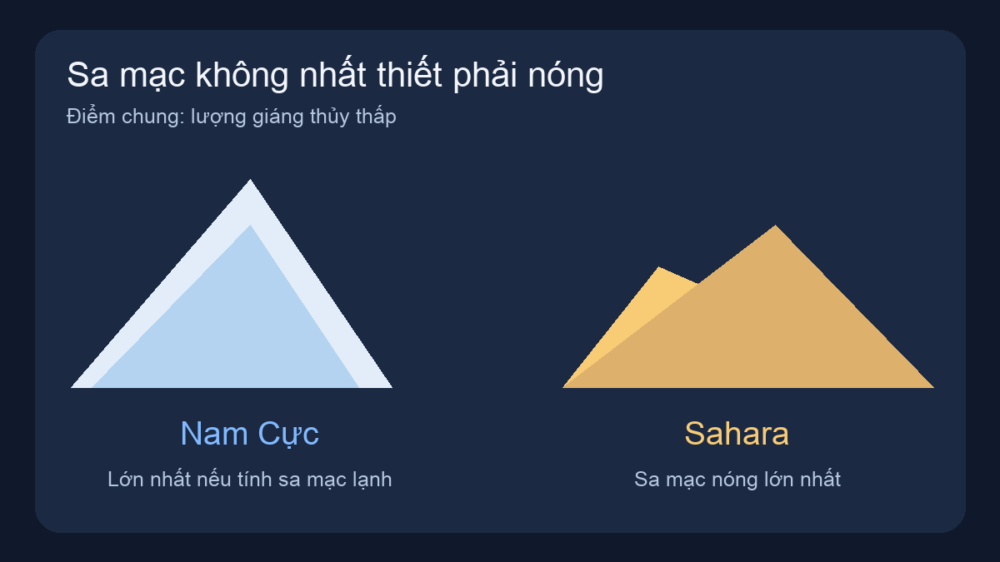
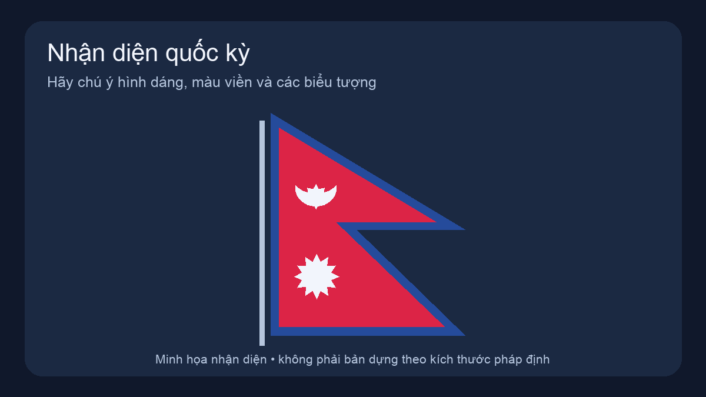
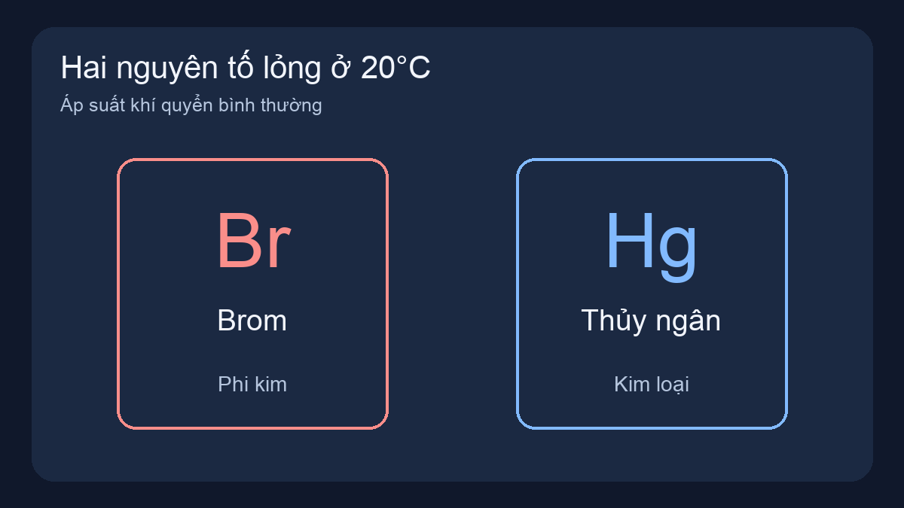
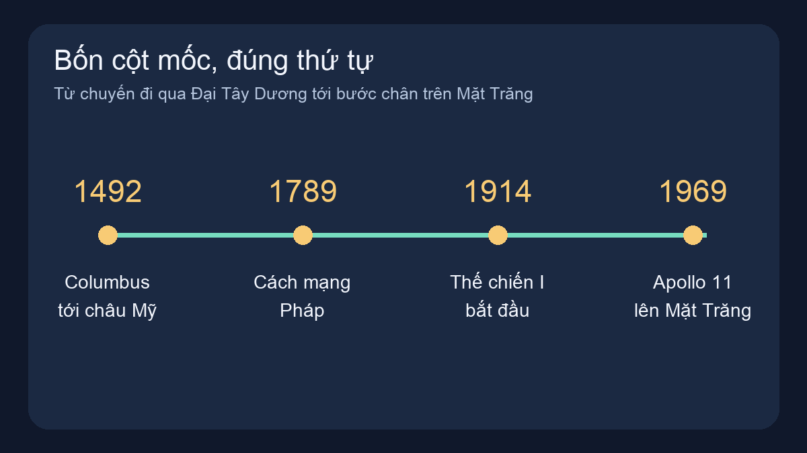
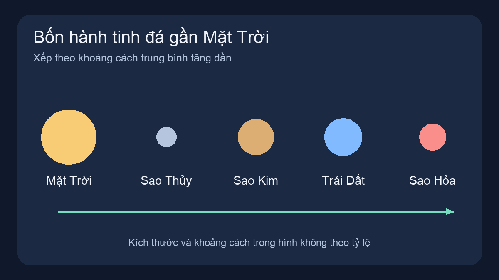

# Đi một vòng thế giới — 20 điều thú vị

20 câu mức vừa về lịch sử, địa lý, khoa học và văn hóa. Sáu dạng câu hỏi, ảnh nhận diện và sơ đồ giải thích. Chơi khoảng 10 phút.

Đáp án bên dưới; nên chơi trong app trước khi đọc.

## 1. Sydney và Melbourne rất nổi tiếng, nhưng thủ đô của Úc là thành phố nào?

- A. Sydney
- B. Canberra
- C. Melbourne
- D. Perth

**Đáp án:** B. Canberra

Canberra là thủ đô Úc, được chọn trong quá trình tìm địa điểm đặt thủ đô liên bang giữa Sydney và Melbourne.

## 2. Vị vua nào dời đô từ Hoa Lư ra Đại La và đặt tên kinh đô là Thăng Long năm 1010?

- A. Lý Thánh Tông
- B. Trần Thái Tông
- C. Lê Đại Hành
- D. Lý Thái Tổ

**Đáp án:** D. Lý Thái Tổ

Lý Thái Tổ (Lý Công Uẩn) dời đô năm 1010. Đừng nhầm với Lý Thánh Tông, vị vua đổi quốc hiệu thành Đại Việt năm 1054.

## 3. Hành tinh nào mất nhiều thời gian tự quay một vòng hơn thời gian đi một vòng quanh Mặt Trời?

- A. Sao Kim
- B. Sao Hỏa
- C. Sao Mộc
- D. Sao Hải Vương

**Đáp án:** A. Sao Kim

Sao Kim tự quay một vòng khoảng 243 ngày Trái Đất, nhưng quay quanh Mặt Trời chỉ khoảng 225 ngày. Đây là chu kỳ tự quay, khác khoảng giữa hai lần Mặt Trời mọc.

## 4. Nhìn sơ đồ: Mặt Trăng che ánh sáng Mặt Trời tới một vùng trên Trái Đất. Người ở vùng đó quan sát hiện tượng gì?

- A. Nguyệt thực
- B. Cực quang
- C. Nhật thực
- D. Mưa sao băng

**Đáp án:** C. Nhật thực

Nhật thực xảy ra khi Mặt Trăng nằm giữa Mặt Trời và Trái Đất, che khuất Mặt Trời với người ở vùng bóng. Nguyệt thực có Trái Đất ở giữa.

## 5. Kênh đào Suez giúp tàu thuyền đi tắt giữa hai vùng biển nào?

- A. Biển Đen và Biển Caspi
- B. Địa Trung Hải và Biển Đỏ
- C. Đại Tây Dương và Thái Bình Dương
- D. Biển Baltic và Biển Bắc

**Đáp án:** B. Địa Trung Hải và Biển Đỏ

Suez ở Ai Cập nối Địa Trung Hải với Biển Đỏ. Kênh Panama mới là tuyến nối Đại Tây Dương với Thái Bình Dương.

## 6. Trong chiến thắng Bạch Đằng năm 1288, vị tướng nào chỉ huy quân Đại Việt đánh quân Nguyên bằng trận địa cọc?

- A. Ngô Quyền
- B. Lê Hoàn
- C. Trần Hưng Đạo
- D. Lê Lợi

**Đáp án:** C. Trần Hưng Đạo

Trần Hưng Đạo chỉ huy chiến thắng năm 1288. Cũng trên sông Bạch Đằng, Ngô Quyền thắng quân Nam Hán năm 938, còn Lê Hoàn thắng quân Tống năm 981.

## 7. Di sản nào ở Việt Nam được UNESCO ghi danh năm 2014 theo cả giá trị văn hóa lẫn thiên nhiên?

- A. Quần thể danh thắng Tràng An
- B. Phố cổ Hội An
- C. Thánh địa Mỹ Sơn
- D. Hoàng thành Thăng Long

**Đáp án:** A. Quần thể danh thắng Tràng An

Tràng An là di sản hỗn hợp văn hóa và thiên nhiên. Cảnh quan đá vôi, hang động và dấu tích cư trú của con người cùng tạo nên giá trị di sản.

## 8. Nếu tính cả sa mạc lạnh, sa mạc có diện tích lớn nhất thế giới nằm ở đâu?

- A. Sahara
- B. Bán đảo Ả Rập
- C. Gobi
- D. Nam Cực

**Đáp án:** D. Nam Cực

Nam Cực là sa mạc lớn nhất khi tính cả sa mạc lạnh. Sa mạc được xác định chủ yếu bởi lượng mưa, tuyết ít, không phải cứ nóng và nhiều cát mới là sa mạc.

## 9. Lĩnh vực nào sau đây không có một hạng mục giải Nobel riêng?

- A. Vật lý
- B. Hóa học
- C. Toán học
- D. Văn học

**Đáp án:** C. Toán học

Không có hạng mục Nobel Toán học. Các giải lớn của toán học gồm Huy chương Fields và giải Abel; một nhà toán học vẫn có thể nhận Nobel trong lĩnh vực khác.

## 10. Di tích Machu Picchu của nền văn minh Inca nằm ở quốc gia nào?

- A. Mexico
- B. Peru
- C. Ai Cập
- D. Campuchia

**Đáp án:** B. Peru

Machu Picchu nằm trên dãy Andes ở Peru, là một di tích tiêu biểu của nền văn minh Inca. Aztec là nền văn minh khác, gắn với Mexico.

## 11. Cây cà phê Arabica có nguồn gốc tự nhiên ở châu lục nào, trước khi được trồng rộng rãi ở Brazil và Việt Nam?

- A. Nam Mỹ
- B. Châu Á
- C. Châu Âu
- D. Châu Phi

**Đáp án:** D. Châu Phi

Arabica có nguồn gốc ở châu Phi, đặc biệt gắn với vùng cao Ethiopia. Quốc gia trồng nhiều cà phê ngày nay không nhất thiết là nơi cây có nguồn gốc.

## 12. Lá cờ hai đuôi nheo trong hình là quốc kỳ của nước nào?

- A. Nepal
- B. Bhutan
- C. Sri Lanka
- D. Mông Cổ

**Đáp án:** A. Nepal

Đây là quốc kỳ Nepal: hai đuôi nheo ghép lại, nền đỏ viền xanh, có biểu tượng Mặt Trăng và Mặt Trời.

## 13. Chọn TẤT CẢ những động vật có vú nhưng đẻ trứng trong danh sách.

- A. Cá heo
- B. Thú mỏ vịt
- C. Thú lông nhím (echidna)
- D. Chim cánh cụt

**Đáp án:** B. Thú mỏ vịt; C. Thú lông nhím (echidna)

Thú mỏ vịt và echidna là thú đơn huyệt, đẻ trứng nhưng vẫn nuôi con bằng sữa. Chim cánh cụt cũng đẻ trứng, nhưng thuộc lớp chim.

## 14. Ở 20°C và áp suất khí quyển bình thường, chọn TẤT CẢ các nguyên tố ở trạng thái lỏng.

- A. Brom (Br)
- B. Sắt (Fe)
- C. Thủy ngân (Hg)
- D. Nhôm (Al)

**Đáp án:** A. Brom (Br); C. Thủy ngân (Hg)

Brom và thủy ngân đều lỏng ở 20°C. Brom là phi kim, thủy ngân là kim loại; sắt và nhôm ở trạng thái rắn trong điều kiện này.

## 15. Trong chân không lý tưởng, âm thanh vẫn truyền từ nguồn phát đến tai người nghe như trong không khí.

**Đáp án:** Sai

Âm thanh là sóng cơ, cần môi trường vật chất để truyền. Trong chân không lý tưởng, ánh sáng vẫn truyền được còn âm thanh thì không.

## 16. Các mùa trên Trái Đất chủ yếu xảy ra vì khoảng cách từ Trái Đất đến Mặt Trời thay đổi trong năm.

**Đáp án:** Sai

Nguyên nhân chính là trục Trái Đất nghiêng, làm thay đổi góc chiếu sáng và độ dài ban ngày. Khi Bắc bán cầu là mùa hè thì Nam bán cầu là mùa đông.

## 17. Xếp các sự kiện từ xảy ra SỚM NHẤT đến MUỘN NHẤT.

- C. Chiến tranh thế giới thứ nhất bắt đầu
- A. Columbus tới châu Mỹ
- D. Con người lần đầu đặt chân lên Mặt Trăng
- B. Cách mạng Pháp bùng nổ

**Đáp án:** Columbus tới châu Mỹ → Cách mạng Pháp bùng nổ → Chiến tranh thế giới thứ nhất bắt đầu → Con người lần đầu đặt chân lên Mặt Trăng

Thứ tự: Columbus tới châu Mỹ (1492) → Cách mạng Pháp (1789) → Thế chiến I (1914) → Apollo 11 đưa người lên Mặt Trăng (1969).

## 18. Xếp bốn hành tinh theo khoảng cách trung bình tới Mặt Trời, từ GẦN đến XA.

- C. Trái Đất
- A. Sao Thủy
- D. Sao Hỏa
- B. Sao Kim

**Đáp án:** Sao Thủy → Sao Kim → Trái Đất → Sao Hỏa

Bốn hành tinh đá theo thứ tự từ Mặt Trời ra ngoài là Sao Thủy → Sao Kim → Trái Đất → Sao Hỏa. Vành đai tiểu hành tinh nằm xa hơn, trước Sao Mộc.

## 19. Quang Trung đại phá quân Thanh trong chiến thắng Ngọc Hồi – Đống Đa vào năm nào?

**Đáp án:** 1789

Đáp án là năm 1789, tức Tết Kỷ Dậu. Chiến dịch đánh tan quân Thanh gắn liền với tên tuổi Hoàng đế Quang Trung.

## 20. Hệ chữ nào là nền tảng của chữ Quốc ngữ tiếng Việt? (Nhập tên hệ chữ.)

**Đáp án:** Latinh

Chữ Quốc ngữ dùng hệ chữ Latinh, bổ sung dấu thanh và các chữ như ă, â, ê, ô, ơ, ư, đ để ghi âm tiếng Việt.
